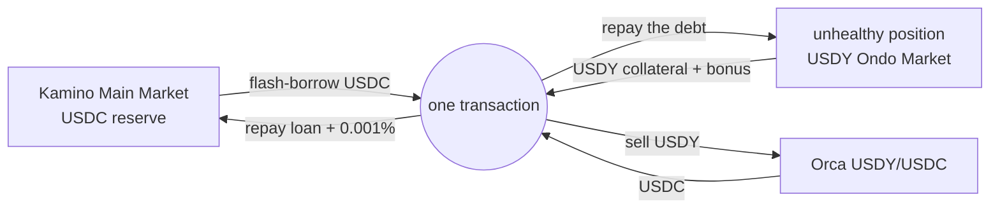

# Kamino liquidation bot — USDY collateral / USDC debt

[](https://github.com/Nysa-Finance/Liquidator/actions/workflows/ci.yml)
[](https://github.com/Nysa-Finance/Liquidator/actions/workflows/canary.yml)
[](LICENSE)

Liquidates unhealthy positions on the **USDY Ondo Market** of
[Kamino Lend](https://kamino.com/curators/markets/F4uLsGZT4YnHDcemtoYDz2LBZKLmwTB1wzkwS6oqygvy)
(`F4uLsGZT4YnHDcemtoYDz2LBZKLmwTB1wzkwS6oqygvy`, curated by Nysa Finance), with
no capital of its own: a **USDC flash loan** repays the debt, the seized
**USDY** is sold on an **Orca Whirlpool**, and the loan is repaid, all in one
atomic transaction.

> **Use at your own risk.** This software signs and submits transactions with a
> key you provide. It comes with no warranty, is not financial advice, and can
> lose money in ways its authors did not foresee. Read [Disclaimer](#disclaimer)
> before running it with `DRY_RUN=false`.



If any step comes up short, the whole transaction reverts and the flash loan
never happened. The worst case of an attempt is its network fee.

## Safety, by design

The rule throughout: **the worst case is a network fee, never capital.**

- **Guards on-chain, not only in code.** Every transaction carries a minimum
  collateral to receive (`minAcceptableReceivedLiquidityAmount`) and a minimum
  USDC out of the swap (`otherAmountThreshold`). Slippage, a sandwich or an RPC
  serving false state make the chain reject the transaction.
- **Two prices, one check.** Kamino values the collateral with the Scope oracle;
  the exit is at the Orca price. When the two diverge by more than
  `MAX_ORACLE_DIVERGENCE_BPS` the bonus can vanish into the gap, so the plan is
  dropped.
- **No stale data.** Health is recomputed from live oracle prices, exactly as
  the program will, rather than from prices stored at the last refresh. A plan
  whose snapshot is more than `MAX_SNAPSHOT_AGE_SLOTS` old is thrown away.
- **Simulate, then check the money.** Every transaction is simulated and the
  USDC that would actually land is checked, not just the absence of an error.
  After confirmation the real balances are read back and reconciled against the
  estimate.
- **Honest accounting.** Planning prices the worst fee the bot would pay, then
  rechecks with the real one. Priority fees are capped twice (absolute, and a
  share of expected profit), and fees burned on failed attempts are counted.
- **Off by default.** Sending happens only with `DRY_RUN=false` spelled exactly;
  any other value, or a typo, keeps the bot observing. Without its lookup table
  it refuses to start live, since the transaction would not fit.
- **Tested against the real programs.** The test suite runs the actual klend and
  Orca programs on a local fork of mainnet state, and a daily canary fails when
  the market's on-chain parameters stop matching what the bot assumes.

## The transaction

```
0  ComputeBudget  setComputeUnitLimit
1  ComputeBudget  setComputeUnitPrice
2  klend          refreshReserve(USDC)              + Scope
3  klend          refreshReserve(USDY)              + Scope
4  klend          refreshObligation                 + reserves in remaining accounts
5  klend          flashBorrowReserveLiquidity       <- Main Market USDC
6  klend          liquidateObligationAndRedeemReserveCollateralV2
7  whirlpool      swapV2  USDY -> USDC  (aToB = true)
8  klend          flashRepayReserveLiquidity        borrowInstructionIndex = 5
```

Uncompressed it serializes to ~1,540 bytes against Solana's 1,232-byte limit; an
address lookup table holding the 35 fixed accounts brings it to ~614.

## Verified numbers

As of mid-October 2026; the canary re-checks the parameters daily.

| | |
|---|---|
| USDY liquidation bonus | **200–500 bps** |
| Close factor | **25%** (100% above the insolvency LTV) |
| Flash loan fee (Main Market USDC) | **0.001%** (`flash_loan_fee_sf = 11529215046068`, 2^60 scale) |
| Flash loan liquidity | **~6M USDC** (varies) |
| Orca USDY/USDC pool fee | **0.16%** |
| Price impact selling 50,000 USDY, fee excluded | **~0.02%** |
| Market permissioned? | **No**: liquidation is permissionless |

## Quick start

Requires Node 24 and npm 12.

```bash
npm install
cp .env.example .env    # set RPC_PRIMARY and KEYPAIR_PATH
npm run preflight       # read-only: reports exactly what is missing
npm start               # dry run: observes and simulates, never submits
```

The RPC must allow `getProgramAccounts` on the klend program; many free tiers
do not. A dedicated keypair holding only SOL for fees is enough, since the
flash loan provides the capital.

One-off on-chain setup before a live run: three token accounts and the lookup
table (spends ~0.011 SOL of rent; safe to re-run, it resumes):

```bash
npm run setup                # show the plan
npm run setup -- --confirm   # create it, then put LOOKUP_TABLE= in .env
```

Every setting is documented in [.env.example](.env.example).

## Running in production

A two-stage [Dockerfile](Dockerfile) and a hardened
[docker-compose.yml](docker-compose.yml): read-only filesystem, no
capabilities, no published ports, a dedicated uid, the key mounted read-only and
never baked into the image. A systemd unit and install script are in
[deploy/](deploy/) for hosts without Docker, along with a read-only
[security check](deploy/check-security.sh) for the host.

The bot is built to run unattended: boot retries a failing RPC, the loop backs
off instead of exiting, and SIGTERM stops it within a second.

**Telegram** (optional): alerts for start and stop, RPC down and recovered, low
SOL, every liquidation won or lost, and a daily summary; plus commands in the
same chat: `/status`, `/market`, `/wallet`, `/last`, and for admins `/pause` and
`/resume CONFIRM`. From Telegram the bot can only become more careful: nothing
there turns sending on, changes a threshold or moves funds.

Full runbook, go-live sequence and day-2 operations:
[docs/05-operations.md](docs/05-operations.md).

## Tests

```bash
npm run fixtures    # pull the real programs and accounts from mainnet
npm test            # 33 tests, local, no network
npm run test:live   # 6 read-only tests against mainnet, no key
npm run test:ready  # is the target market open for business?
```

The local suite runs **the full production path** in LiteSVM: a lender supplies
USDC, a borrower deposits USDY and borrows through klend's own instructions, the
oracle drops, the position crosses its threshold, and the bot's transaction
builder liquidates it:

```
repaid 5000 USDC, seized ~4658.65 USDY, profit 348.68 USDC, residue 245.19 USDY, CU 271554
```

It also checks that the flash loan pair fails, as it must, when
`borrowInstructionIndex` is off by one, and that a real `swapV2` matches the
off-chain quote to the unit (**0.000 bps** of drift). The rest covers the
planner, settlement, the Telegram command surface and RPC edge cases.

CI runs the typecheck and the local suite on every push. The daily
[canary](.github/workflows/canary.yml) runs the read-only mainnet checks and
publishes [docs/TEST-REPORT.md](docs/TEST-REPORT.md).

## Documentation

| File | Contents |
|---|---|
| [01-protocol.md](docs/01-protocol.md) | Protocol reference: instructions, accounts, constraints, target-market findings |
| [02-design.md](docs/02-design.md) | The atomic transaction and the bot's architecture |
| [03-profitability.md](docs/03-profitability.md) | Profit equation and execution thresholds |
| [04-testing.md](docs/04-testing.md) | Testing tiers: local fork, live read-only, readiness gate |
| [05-operations.md](docs/05-operations.md) | Deployment, security, go-live sequence, day-2 operations |
| [TEST-REPORT.md](docs/TEST-REPORT.md) | Generated output of every suite, with commit and slot |

## Project layout

```
src/
  index.ts              the main loop
  config.ts             verified constants + .env, validated at start-up
  rpc.ts                RPC pool with failover, key loading
  eligibility.ts        "is it liquidatable?": off-chain replica of the rules
  profit.ts             "is it worth it?": profit equation and thresholds
  execute.ts            simulation, priority fee, submission, reconciliation
  build/                klend, Orca and compute-budget instructions; tx assembly
  alert.ts              Telegram alerts
  commands.ts           Telegram commands
  status.ts             in-memory state behind the commands
  scanner.ts            health prefilter over all positions (dataSlice)
  readonly.ts           RPC client that refuses every write (tests, preflight)
scripts/                preflight, setup, Orca quote, fixtures, test report
tests/                  local fork (LiteSVM), live read-only, readiness gate
deploy/                 systemd unit, install script, host security check
```

## Status

Running in dry run against the target market, which is not yet open to the
public. Everything up to and including simulation is exercised on mainnet every
round; submission itself is covered only by the local fork until the first live
liquidation.

## Security

Please report vulnerabilities privately: see [SECURITY.md](SECURITY.md).

## Disclaimer

This software is provided "as is", without warranty of any kind (see
[LICENSE](LICENSE)). It is not financial, legal or investment advice, and
nothing in this repository is an offer or a recommendation.

Running it means signing transactions with a private key on a networked
machine. You are responsible for that key, for the funds on it, for every
transaction it signs, and for complying with the laws that apply to you. USDY
is subject to its issuer's eligibility and transfer restrictions; check that
they allow you to hold it. Protocols this bot depends on (Kamino, Orca, Scope)
can change their parameters or code at any time, and a change can make a
liquidation fail or lose money despite the safeguards above.

## License

[MIT](LICENSE)
